<p align="center">
  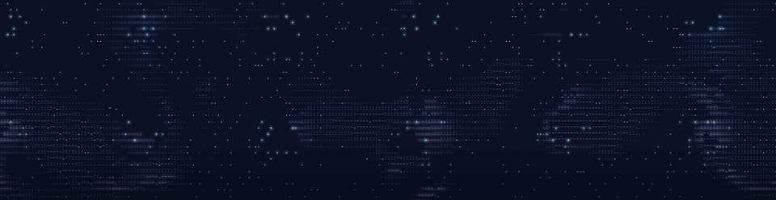
</p>

<h3 align="center">Interfaces drawn in living glyphs.</h3>

<p align="center">
  A design language and a tiny engine for building web interfaces out of full-color text characters,<br>
  driven by real simulation, finished with a soft glow. One file. No dependencies. No build step.
</p>

<p align="center">
  <a href="https://github.com/rader-ai/Glyphmotion/releases/latest"></a>
  <a href="LICENSE"></a>
  
  
  
</p>

<p align="center">
  <a href="#quick-start"><b>Quick start</b></a> &nbsp;·&nbsp;
  <a href="#the-gallery"><b>Gallery</b></a> &nbsp;·&nbsp;
  <a href="docs/api.md"><b>API</b></a> &nbsp;·&nbsp;
  <a href="docs/principles.md"><b>Principles</b></a> &nbsp;·&nbsp;
  <a href="https://github.com/rader-ai/Glyphmotion/releases/latest"><b>Download</b></a>
</p>

<br>

```
 .:-=+*#%@   every pixel is a character.   @%#*+=-:.
```

## Not ASCII art. A medium.

Glyphmotion treats a grid of characters the way a game engine treats pixels. Every cell is a glyph with its own color. Water, fire, flocks, weather and phosphor run as real simulation underneath, and the characters are how you see them.

- **Simulated, not drawn.** Waves break, sparks fall, fish school, storms gather. Nothing is a looping sprite.
- **The interface is the medium.** A button is a pool of molten metal you stir with your cursor. A menu pours open. A logo assembles out of drifting light.
- **Behavior, not loops.** Things settle, notice you, get bored and fall asleep.

<p align="center">
  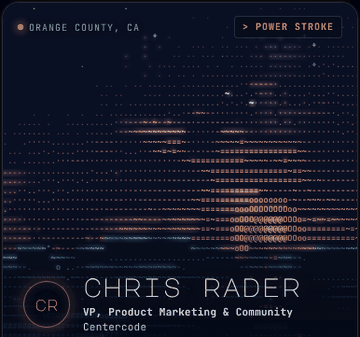
  <br><sub>Where it started: a whale breaching behind a profile card. <a href="examples/profile-card.html">examples/profile-card.html</a></sub>
</p>

## Quick start

Drop one script on a page and give it a canvas.

```html
<canvas id="sea" style="width:100%;height:320px"></canvas>
<script src="https://cdn.jsdelivr.net/gh/rader-ai/Glyphmotion@v0.1.0/src/glyphmotion.js"></script>
<script>
  const { fbm, ramp, smooth } = Glyphmotion;

  Glyphmotion.surface(document.getElementById('sea'), {
    draw(s) {
      for (let r = 0; r < s.rows; r++) for (let c = 0; c < s.cols; c++) {
        const v = smooth(0.4, 0.8, fbm(c * 0.05 + s.time * 0.1, r * s.asp * 0.05));
        s.putI(r * s.cols + c, v < 0.05 ? ' ' : ramp(v), 60, 160 + 90 * v, 220);
      }
    }
  });
</script>
```

That is a living, glowing smoke field. The script is pinned to `v0.1.0`, so it never changes under you; swap in `@main` to ride the latest. Or clone the repo and open `index.html`. Every page runs straight from the file system.

```sh
git clone https://github.com/rader-ai/Glyphmotion.git
open Glyphmotion/index.html
```

## The gallery

Four AI agent teams were each given the same brief: invent a complete design language in this medium, with a logo, buttons, menus, cursor, hero, footer and one moment worth sharing. Six judges scored them on uniqueness, quality, artistry, viral potential, accuracy and measured performance.

<table>
  <tr>
    <td width="50%" valign="top">
      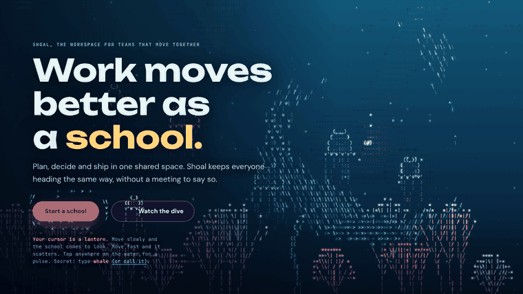
      <br><b>Shoal</b> &nbsp;<sub>champion, 45.5 of 60</sub>
      <br><sub>A living ecosystem. The logo is about 1,500 fish. Type <code>whale</code> anywhere.</sub>
      <br><sub><a href="gallery/championship/team-creatures.html">gallery/championship/team-creatures.html</a></sub>
    </td>
    <td width="50%" valign="top">
      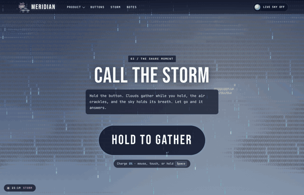
      <br><b>Meridian</b> &nbsp;<sub>second, 40.5</sub>
      <br><sub>One sky from dawn to deep space as you scroll. Hold the button to call the storm.</sub>
      <br><sub><a href="gallery/championship/team-sky.html">gallery/championship/team-sky.html</a></sub>
    </td>
  </tr>
  <tr>
    <td width="50%" valign="top">
      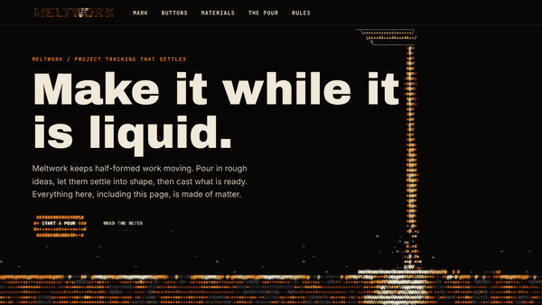
      <br><b>Meltwork</b> &nbsp;<sub>third, 39</sub>
      <br><sub>Every control is a material with a meaning. Molten metal commits, ink chooses, smoke dismisses.</sub>
      <br><sub><a href="gallery/championship/team-matter.html">gallery/championship/team-matter.html</a></sub>
    </td>
    <td width="50%" valign="top">
      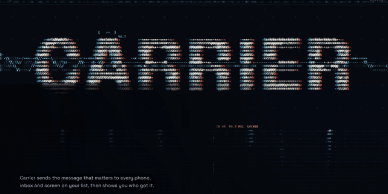
      <br><b>Carrier</b> &nbsp;<sub>fourth, 38.5</sub>
      <br><sub>The page as a radio instrument, with phosphor afterglow. Hold Space, then release.</sub>
      <br><sub><a href="gallery/championship/team-signal.html">gallery/championship/team-signal.html</a></sub>
    </td>
  </tr>
</table>

### Mascots with real feelings

Then each team built a living mascot: at least seven emotions, real movement, and reactions to the visitor, to typing, to idle time, to the time of day and to page events like a form error or a successful signup.

<table>
  <tr>
    <td width="25%" valign="top" align="center">
      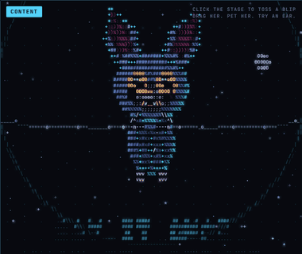
      <br><b>Vesper</b><br><sub>A bat whose ears light up when the echo comes back. Click an ear.</sub>
    </td>
    <td width="25%" valign="top" align="center">
      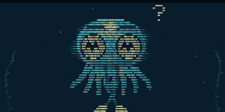
      <br><b>Nib</b><br><sub>A cuttlefish that wears every mood on its skin. Drop it a snack.</sub>
    </td>
    <td width="25%" valign="top" align="center">
      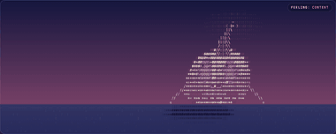
      <br><b>Nomi</b><br><sub>A sundial keeper. Your pointer is the sun. Slide the pin to move it.</sub>
    </td>
    <td width="25%" valign="top" align="center">
      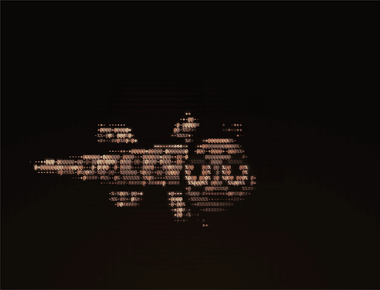
      <br><b>Fettle</b><br><sub>A slag salamander. How it feels is how hot it glows. Type <code>melt</code>.</sub>
    </td>
  </tr>
</table>

<sub>Pitches: <a href="gallery/mascots/signal.html">Vesper</a> · <a href="gallery/mascots/creatures.html">Nib</a> · <a href="gallery/mascots/sky.html">Nomi</a> · <a href="gallery/mascots/matter.html">Fettle</a>. Each has a live emotion sheet, a playground and the losing sketches.</sub>

### Components you can lift

<table>
  <tr>
    <td width="50%" valign="top">
      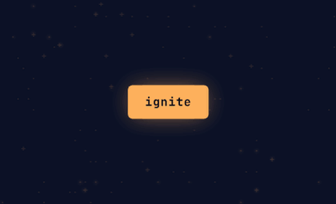
      <br><b>Ember button</b><br><sub>Sparks on hover, a burst and a ring on press. <a href="examples/button.html">examples/button.html</a></sub>
    </td>
    <td width="50%" valign="top">
      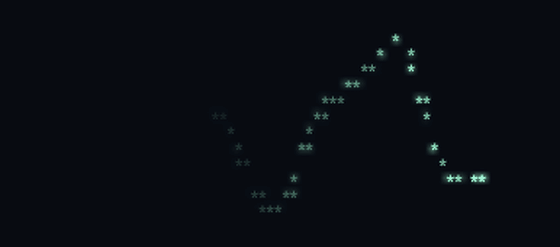
      <br><b>Afterglow</b><br><sub>Phosphor persistence, see-through glyphs and a page-wide pointer. <a href="examples/afterglow.html">examples/afterglow.html</a></sub>
    </td>
  </tr>
</table>

Plus a component lab with heroes, stat tiles driven by their own numbers, fire pricing cards, an upload that builds a skyline, a lighthouse 404, weather dialogs, city event cards and a harbor footer. See [`gallery/lab/`](gallery/lab).

## What the engine handles for you

You write the world. Glyphmotion does the parts that are easy to get wrong.

| Feature | What you get |
|---|---|
| **One loop** | Every canvas on the page shares one animation loop, with a fixed 60Hz simulation and a 30fps paint. |
| **Zero wasted work** | Canvases off screen do nothing. Everything pauses when the tab is hidden. Idle layers skip their paint. |
| **Sharp everywhere** | High-density screens, resize, and late-arriving web fonts are handled for you. |
| **The glow** | A cheap bloom pass that makes characters feel lit, not printed. |
| **Phosphor** | `persistence` keeps glyphs glowing after they stop being drawn, with a linear or long exponential tail. |
| **See-through glyphs** | Per-cell opacity, transparent overlays, and a paint hook for gradients and glows beneath the characters. |
| **Pointer anywhere** | Track the pointer page-wide, even on overlays that never block a click. |
| **Wordmarks** | Rasterize a word into the grid with letter spacing, stretch and ink centering, then animate every cell. |
| **Calm when asked** | Under `prefers-reduced-motion` there is no loop at all. Each scene shows a composed still frame, and interactions still answer. |

Plus noise, layered noise, springs, character ramps, direction glyphs and a zero-allocation particle pool. Full reference in [docs/api.md](docs/api.md).

## Built to be shipped

- **Fast.** The championship winner held about 57 frames a second with almost no long tasks under a measured stress test. The engine is 7.7 KB gzipped.
- **Accessible.** Real buttons and links, visible keyboard focus, labeled or hidden canvases, and text that never fights the animation.
- **Checked.** `node tools/check.js` loads every page at desktop and phone width and fails on errors, sideways scrolling, outside scripts, network calls and loops that ignore reduced motion.

## How it was made

Glyphmotion started as one whale breaching behind a profile card. It grew through a component lab, a four-team design language championship judged by a six-judge panel, a mascot challenge, and finally an engine pulled out of everything that worked. Every brief and every judge's scorecard is in [docs/history](docs/history).

Created by **Chris Rader**, who builds AI agents and product experiences, directing teams of Claude agents from first sketch to shipped engine.

## Use it

MIT licensed. Use it, remix it, ship it in your product. A star or a credit back to Glyphmotion helps more people find it.

<p align="center">
  <a href="https://github.com/rader-ai/Glyphmotion/releases/latest"><b>Download the latest release</b></a> &nbsp;·&nbsp;
  <a href="docs/api.md"><b>Read the API</b></a> &nbsp;·&nbsp;
  <a href="index.html"><b>Open the landing page</b></a>
</p>

```
 @%#*+=-:.   glyphmotion   .:-=+*#%@
```
